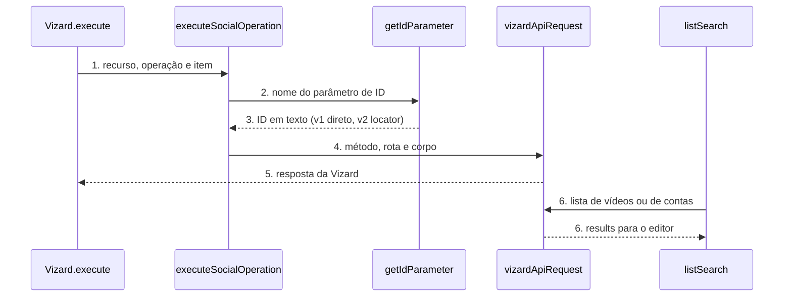

# Vizard: node-cli 0.55 e campos guiados (versão 2 do node)

**Approved**: 2026-11-06 - user: "Aprovo com antecedência (Recomendado · Jev 0,96)"

> Build this with **tlc-implement**. Every criterion becomes a check with a proof; nothing under
> the open questions is settled while building.

## Problem

O pacote `n8n-nodes-vizard` 1.0.0 já usa o `@n8n/node-cli` 0.38.8 e tem 14 testes em `test/vizard.test.cjs`. O `n8n-node lint` do 0.55.5 acusa 1 erro: a categoria `Marketing` do `Vizard.node.json` não existe mais, e o valor aceito é `Marketing & Content`. A devDependency `n8n-workflow` está em `^2.16.0`, e a `stable` do npm é 2.46.5. O `publish.yml` roda `npm run release` com o token `NPM_TOKEN`, que agora é "stage only" e recusa esse comando. O README tem 124 linhas e não segue o padrão completo dos outros pacotes. O `package.json` não tem `funding`.

Quem usa o node digita à mão dois campos: o Final Video ID (número que vem de dentro do `videos[]` de Get Project Output) e o Social Account ID (texto que vem de Get Connected Accounts). Para achar cada um, a pessoa roda outra operação, abre a saída e copia o valor. A UX guideline do n8n manda usar Resource Locator com `From list` como padrão.

Quando isso sair: o lint oficial passa com 0 erros, a publicação passa pelo estágio com aprovação, e em node novo os dois campos mostram uma lista com nome legível, com a opção de colar o ID. Workflows salvos continuam iguais.

## Shape

Reutiliza `vizardApiRequest` (exists) para as duas listas e `executeSocialOperation` (exists) para a chamada final. A regra que muda o resultado, ler o ID na versão 1 (valor direto) ou na versão 2 (Resource Locator), fica numa função única de leitura de ID que os testes alcançam pelo `execute` do node com contexto falso.

1. entra o item do workflow -> `Vizard.execute` (exists) - lê `resource` e `operation`, chama `executeSocialOperation`
2. `executeSocialOperation` (exists) - chama a leitura de ID para `finalVideoId` e `socialAccountId`
3. `getIdParameter` (new) - na versão 1 devolve o valor do parâmetro; na versão 2 devolve o `value` do Resource Locator sem espaço nas pontas
4. `vizardApiRequest` (exists) - monta a requisição com `timeout` de 180000 e chama `httpRequestWithAuthentication`
5. out: a resposta da Vizard como itens do n8n, igual à 1.0.0
6. editor -> `listSearch` (new) - `searchVideos` chama `GET /query/{projectId}` e `searchSocialAccounts` chama `GET /social-accounts`, e cada um devolve `{ name, value }`

**Changes underneath**

| Front | What changes |
| --- | --- |
| domain | nada: os recursos e as operações não mudam |
| stored data | nothing to migrate: workflows salvos guardam `typeVersion` 1 e continuam lendo os parâmetros antigos |
| readers | o editor do n8n mostra a versão 2 só em node novo |
| toolchain | `package.json`, `Vizard.node.json`, `publish.yml`, `README.md` e `CHANGELOG.md` passam para o padrão do 0.55.5 e do dono |

Data: none - o node não guarda dado; ele repassa a requisição para a Vizard e devolve a resposta.

New: nothing - read only.

## Surface

| Route | In | Out | Status | Who |
| --- | --- | --- | --- | --- |
| node `vizard` versão 2 | `finalVideoId` e `socialAccountId` como Resource Locator com modo `list` ou `id`, mais `projectId` nas operações Generate AI Caption e Publish Video | a mesma resposta da versão 1 | `200`; `401` da Vizard com chave inválida vira `NodeApiError` | quem tem credencial Vizard válida; sem ela a Vizard devolve `401` |
| node `vizard` versão 1 | `finalVideoId` numérico e `socialAccountId` em texto, iguais à 1.0.0 | igual à 1.0.0 | `200`; `401` vira `NodeApiError` | workflows salvos com credencial Vizard válida; sem ela, `401` |
| `listSearch` `searchVideos` | `projectId` e texto de busca | `{ results: [{ name, value }] }` | `200`; `401` e `4001` viram `NodeApiError` | o editor do n8n com credencial Vizard válida; sem ela, `4001` |
| `listSearch` `searchSocialAccounts` | texto de busca | `{ results: [{ name, value }] }` | `200`; `401` e `4001` viram `NodeApiError` | o editor do n8n com credencial Vizard válida; sem ela, `4001` |

## Landing

| One-way door | Literal shape | Alternative rejected |
| --- | --- | --- |
| versão do node | `version: [1, 2]`, `defaultVersion: 2`; campos novos com `displayOptions.show['@version']: [{ _cnd: { gte: 2 } }]` e antigos com `[1]` | `VersionedNodeType`: a guia de versionamento do node-cli só o permite com reescrita completa |
| nome dos parâmetros na versão 2 | o mesmo `name` da versão 1 (`finalVideoId`, `socialAccountId`), só o `type` muda para `resourceLocator`; `projectId` já existe e ganha uma segunda definição para as operações sociais | nome novo: obrigaria a ler dois nomes em cada operação |
| versão do pacote | `1.1.0` | `2.0.0`: nenhum workflow salvo quebra |
| publicação | `npx -y npm@12.2.2 stage publish --provenance --access public` com `RELEASE_MODE: 'true'` (AD-004) | `npm run release`: o token "stage only" recusa com `E_STAGE_REQUIRED` |

- Nothing else in this change is hard to reverse

## Criteria

### S1: toolchain do node-cli 0.55.5 (P1)

O pacote compila, passa no lint oficial e roda os testes com os comandos do template.

**Acceptance Criteria**

1. WHEN `npm run lint` roda THEN `n8n-node lint` SHALL sair com código 0 e imprimir 0 erros
   - o `Vizard.node.json` com a categoria `Marketing` → 1 erro; com `Marketing & Content` → 0 erros
2. WHEN `npm run build` roda THEN o sistema SHALL sair com código 0 e gerar `dist/nodes/Vizard/Vizard.node.js`, `dist/credentials/VizardApi.credentials.js` e os ícones `vizard.svg` e `vizard.dark.svg` ao lado do node
3. The `package.json` SHALL ter `@n8n/node-cli` `0.55.5` em `devDependencies`, `n8n-workflow` `^2.46.5`, `peerDependencies` `{ "n8n-workflow": "*" }`, `n8n.strict` `true` e nenhum campo `dependencies`
4. The `package-lock.json` SHALL resolver `n8n-workflow` em 2.46.5 ou mais nova
5. WHEN `npm test` roda THEN o sistema SHALL compilar e rodar `node --test test/*.test.cjs` com saída `# fail 0`
6. WHEN um Pull Request abre THEN o workflow de CI (arquivo ci.yml em .github/workflows) SHALL rodar `npm ci`, `npm run lint`, `npm test` e `npm run build`

### S2: versão 1 continua igual (P1)

Workflow salvo na versão 1 envia exatamente a mesma requisição da 1.0.0.

**Acceptance Criteria**

1. WHEN o `execute` roda com `typeVersion` 1, `operation` `publishVideo`, `finalVideoId` 14015572 e `socialAccountId` `'123456'` THEN o sistema SHALL chamar `POST /publish-video` com corpo `{ "finalVideoId": 14015572, "socialAccountId": "123456" }`
2. WHEN o `execute` roda com `typeVersion` 1, `operation` `generateCaption` e `finalVideoId` 14015572 THEN o sistema SHALL chamar `POST /ai-social` com `finalVideoId` 14015572
3. The node SHALL listar, para `@version` 1, todo parâmetro com o mesmo `name` e o mesmo `type` da 1.0.0, e `finalVideoId` SHALL continuar `number`
4. IF `finalVideoId` na versão 1 é 0 THEN o sistema SHALL lançar `NodeOperationError` com a mensagem `Final Video ID must be a positive integer`

### S3: campos guiados na versão 2 (P1)

Em node novo, o vídeo e a conta social são escolhidos numa lista pesquisável, com modo ID para colar.

**Acceptance Criteria**

1. WHEN alguém adiciona o node a um workflow novo THEN o sistema SHALL criá-lo com `typeVersion` 2
2. The node SHALL expor, para `@version` 2, `finalVideoId` (operações Generate AI Caption e Publish Video) e `socialAccountId` (operação Publish Video) como `resourceLocator` com os modos `list` (padrão, `searchable: true`) e `id`
3. The node SHALL expor, para `@version` 2, um `projectId` obrigatório nas operações Generate AI Caption e Publish Video, com a descrição `Project that holds the video; use the ID returned when the video was submitted`
4. WHEN o editor pede a lista de `finalVideoId` com `projectId` `'17861706'` THEN `searchVideos` SHALL chamar `GET /query/17861706` e devolver um item por entrada de `videos[]` com `value` igual ao `videoId` e `name` igual ao `title` cortado em 60 caracteres seguido de ` (` e a duração em segundos e ` s)`
   - `videos[]` com 2 entradas → 2 itens; `videos[]` ausente → `results` vazio
5. IF a Vizard responde ao `GET /query/{projectId}` com o código 1000 (em processamento) THEN `searchVideos` SHALL devolver `results` vazio, sem lançar erro
6. WHEN o editor pede a lista de `finalVideoId` com `projectId` vazio THEN `searchVideos` SHALL devolver `results` vazio sem chamar a API
7. WHEN o editor pede a lista de `socialAccountId` THEN `searchSocialAccounts` SHALL chamar `GET /social-accounts` e devolver um item por entrada de `publishAccounts[]` com `value` igual ao `id` e `name` no formato `<platform> - <username>`, usando `page` quando `username` vier vazio
8. WHEN o texto de busca é `insta` THEN os dois `listSearch` SHALL devolver só os itens cujo `name` contém `insta`, sem diferenciar maiúscula e minúscula, filtrando no próprio node porque a Vizard não oferece filtro nas duas rotas
9. WHEN o `execute` roda com `typeVersion` 2 e `finalVideoId` `{ mode: 'list', value: '14015572' }` THEN o sistema SHALL enviar `finalVideoId` 14015572 como número
10. WHEN o `execute` roda com `typeVersion` 2 e `socialAccountId` `{ mode: 'id', value: ' 123456 ' }` THEN o sistema SHALL enviar `socialAccountId` `'123456'` (espaço nas pontas removido)
11. IF o Resource Locator de `finalVideoId` chega com `value` `'abc'` THEN o sistema SHALL lançar `NodeOperationError` com a mensagem `Final Video ID must be a positive integer`
12. IF o Resource Locator de `socialAccountId` chega com `value` vazio THEN o sistema SHALL lançar `NodeOperationError` com a mensagem `Social Account ID is required`
13. The node SHALL manter `usableAsTool: true`, e WHEN um AI Agent preenche `finalVideoId` com expressão THEN o modo `id` SHALL aceitar o valor

### S4: lançamento 1.1.0 com estágio (P2)

A versão nova chega ao npm com provenance depois da aprovação do dono.

**Acceptance Criteria**

1. The `package.json` SHALL ter `"version": "1.1.0"` e o campo `funding` do tipo `individual` apontando para o endereço de apoio do dono (AD-006), e o `CHANGELOG.md` SHALL ter a seção `## 1.1.0` com a categoria corrigida, a versão 2 do node e a migração de toolchain
2. The workflow de publicação (arquivo publish.yml em .github/workflows) SHALL ter `workflow_dispatch` no `on:`, `node-version: 24` igual ao do workflow de CI, o passo `npx -y npm@12.2.2 stage publish --provenance --access public` com `RELEASE_MODE: 'true'` e `NODE_AUTH_TOKEN`, e nenhuma chamada a `npm run release`
3. The `README.md` SHALL ter o selo e a seção "Apoie o projeto", o índice e as seções Funcionalidades, Instalação, Credenciais, Nós e Operações, Usar como Tool de Agente de IA, exemplos, Desenvolvimento, Compatibilidade, Recursos, Publicação, Versões, Suporte e Licença, e SHALL descrever a lista de vídeo por projeto e a lista de conta social
4. WHEN a tag `v1.1.0` chega ao GitHub THEN o workflow SHALL deixar `n8n-nodes-vizard@1.1.0` na fila Staged Packages, e depois da aprovação com 2FA `npm view n8n-nodes-vizard version` SHALL devolver `1.1.0`

## Out of scope

| Excluded | Why |
| --- | --- |
| Lista de templates para `templateId` | A doc da Vizard só diz que o ID aparece na aba Template do editor; não há rota de listagem |
| Lista de projetos para `projectId` de Get Project Output | A doc não tem rota que liste projetos; o ID vem da resposta de Edit Short Video ou Create Clips |
| Detectar `videoType` pela URL | A API exige o tipo explícito e um palpite errado manda o vídeo para o fluxo errado |
| Esperar o projeto terminar (polling) | O pedido é sobre o preenchimento dos campos, não sobre novas operações |
| Parâmetro `Simplify` na saída | O pedido não trata a saída |
| Novos recursos da API Vizard | O pedido não pediu |

## Assumptions

| Assumption | Chosen default | Rationale | Confirmed? |
| --- | --- | --- | --- |
| Valores de `status` de `publishAccounts[]` além de `active` | A lista mostra todas as contas e não filtra por status | A doc só mostra `active`; filtrar esconderia conta que talvez publique | n |
| Paginação de `GET /social-accounts` | Sem `paginationToken`, a rota devolve `total` e a lista inteira | A doc não descreve página nem limite | n |
| `title` ausente em `videos[]` | O nome do item usa `Video <videoId>` | Evita item sem rótulo | n |
| Mensagens e rótulos do node | Continuam em inglês, como o resto do n8n | A UX guideline escreve em inglês e o pacote já é assim | n |
| Posição do `projectId` nas operações sociais | Fica antes de `finalVideoId`, porque a lista depende dele | A lista só funciona com o projeto já preenchido | n |

**Open questions:** none - all resolved or logged above.

## Differences from the source

None - the product matches the source

## Sources

- Pedido do dono, 06/11/2026: "atualizar e melhorar todos os nodes n8n de acordo com a nova versão, deixar mais fácil e intuitivo o preenchimento dos campos, sempre consultar a doc da ferramenta do node" - binding - escopo do trabalho
- Doc da API Vizard (`https://docs.vizard.ai/docs/retrieve-social-accounts`, `https://docs.vizard.ai/docs/retrieve-video-clips`, `https://docs.vizard.ai/docs/publish-clips-to-social-media`, `https://docs.vizard.ai/docs/advanced`), lida pelo Context7 `/websites/vizard_ai` em 06/11/2026 - binding - rotas de listagem, resposta e ausência de rota para templates e projetos
- Template e guias do `@n8n/node-cli` 0.55.5 e UX guidelines do n8n - binding - toolchain, versão leve, Resource Locator
- Medição de lint em 06/11/2026: `n8n-node lint` 0.55.5 em `origin/main` - binding - 1 erro (`valid-node-categories`)
