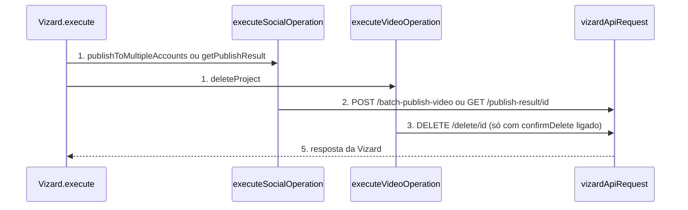

# Vizard: rotas novas da API (publicação em várias contas, resultado, apagar projeto, clipModel)

**Approved**: 2026-11-06 - user: "implementa as rotas novas de todos"

> Build this with **tlc-implement**. Every criterion becomes a check with a proof; nothing under
> the open questions is settled while building.

## Problem

O pacote `n8n-nodes-vizard` 1.1.0 cobre 5 rotas da API da Vizard em 6 operações. A auditoria de 06/11/2026 contra `https://docs.vizard.ai/llms.txt` achou 3 rotas sem operação e 3 campos novos em `POST /create`. Quem publica o mesmo clipe em várias redes hoje chama `Publish Video` uma vez por conta. Quem publicou não consegue ler o resultado da publicação pelo node. Quem quer apagar um projeto de teste precisa de uma chamada HTTP avulsa. O seletor de fonte não oferece Dropbox nem Instagram, e a pessoa não escolhe o modelo `clip_v2`.

Quando isso sair: o node publica em várias contas numa operação só, consulta o resultado, apaga um projeto só depois de uma confirmação explícita, e envia `clipModel` e os tipos de fonte 13 e 14. A versão 1 e a versão 2 do node continuam enviando a mesma requisição nas operações que já existiam.

## Shape

Reutiliza `vizardApiRequest` (exists) para as três chamadas novas, `getIdParameter` (exists) para ler cada conta e `scheduledPublishTime` (exists) para a data. A regra que muda o resultado, montar a string de IDs, validar a confirmação e recusar vazio, fica em `execute.ts` (exists), a camada que o `npm test` alcança pelo `dist`.

1. entra o item do workflow -> `Vizard.execute` (exists) - lê `resource` e `operation` e chama `executeSocialOperation` ou `executeVideoOperation`
2. `executeSocialOperation` (exists) - nas operações `publishToMultipleAccounts` e `getPublishResult` valida os campos e monta o corpo antes de qualquer requisição
3. `executeVideoOperation` (exists) - na operação `deleteProject` confere `confirmDelete` antes de qualquer requisição
4. `vizardApiRequest` (exists) - envia a requisição com `timeout` de 30000 e confere o `code` da resposta
5. out: a resposta da Vizard como item do n8n; resposta vazia vira `{ "success": true }`

**Changes underneath**

| Front | What changes |
| --- | --- |
| domain | nada muda de significado; entram 3 operações e 1 campo, todos aditivos |
| stored data | nothing to migrate: workflows salvos não usam os nomes novos |
| readers | o editor do n8n lista as operações novas nas duas versões do node; o README e a ferramenta de IA descrevem as operações |

Data: none - o node não guarda dado; ele repassa a requisição para a Vizard e devolve a resposta.

New: nothing - read only.

## Surface

| Route | In | Out | Status | Who |
| --- | --- | --- | --- | --- |
| `POST /batch-publish-video` | `socialAccountIds` (texto, IDs separados por vírgula), `post`, `videoUrl`, `title`, `publishTime` | resposta da Vizard sem schema documentado | `200`; `401`; `4001` e `4011` viram `NodeApiError` | quem tem credencial Vizard válida; sem ela, `401` ou `4001` |
| `GET /publish-result/{customVideoId}` | `customVideoId` | resposta da Vizard sem schema documentado | `200`; `401`; `4001` vira `NodeApiError` | quem tem credencial Vizard válida; sem ela, `401` ou `4001` |
| `DELETE /delete/{projectId}` | `projectId` | resposta da Vizard sem schema documentado; vazia vira `{ "success": true }` | `200`; `401`; `4001` vira `NodeApiError` | quem tem credencial Vizard válida; sem ela, `401` ou `4001` |
| `POST /create` | `clipModel` (`clip_v1` ou `clip_v2`), `videoType` 13 ou 14 | `projectId` como antes | `200`; `401`; `4006` vira `NodeApiError` | quem tem credencial Vizard válida; sem ela, `401` ou `4001` |

## Landing

| One-way door | Literal shape | Alternative rejected |
| --- | --- | --- |
| nomes dos parâmetros novos (ficam salvos nos workflows) | `socialAccounts` (coleção `accounts` com `accountId`), `post`, `customVideoId`, `confirmDelete`, `clipModel`; operações `publishToMultipleAccounts`, `getPublishResult`, `deleteProject` | nomes iguais aos da operação `publishVideo`: a coleção de contas e o `post` de topo não cabem no campo `publishingOptions` de uma conta só |
| formato de `socialAccountIds` | texto `"111,222"`, IDs sem espaço, sem repetição (Jev 0,80) | array JSON: a doc declara `type: string` (Jev 0,06); uma chamada por conta: foge do contrato do batch (Jev 0,14) |
| versão do pacote | `1.2.0` | `2.0.0`: nenhum workflow salvo quebra |

- Nothing else in this change is hard to reverse

## Criteria

### S1: publicar em várias contas (P1)

Uma operação nova envia o mesmo vídeo para todas as contas escolhidas.

**Acceptance Criteria**

1. WHEN a operação `publishToMultipleAccounts` roda com `socialAccounts` `{ accounts: [ { accountId: { mode: 'list', value: '111' } }, { accountId: { mode: 'id', value: ' 222 ' } } ] }`, `videoUrl` a URL cdn.example.com/clip.mp4 (https) e `post` `Texto do post` THEN o sistema SHALL chamar `POST /batch-publish-video` com os campos socialAccountIds igual a "111,222", videoUrl igual à URL dada e post igual a "Texto do post", e `timeout` 30000
   - espaço nas pontas removido; o mesmo ID duas vezes (`111`, `111`) → `"111"` uma vez só
2. WHEN `batchPublishingOptions` traz `title` `Meu vídeo` e `publishTime` `2026-12-01T10:00:00Z` THEN o corpo SHALL ter `title` `Meu vídeo` e `publishTime` 1796119200000 (milissegundos, a mesma regra de Publish Video)
3. IF `socialAccounts` não tem nenhuma linha, ou todas as linhas têm valor vazio THEN o sistema SHALL lançar `NodeOperationError` com a mensagem `Select at least one social account` sem fazer requisição
4. IF um ID de conta contém vírgula THEN o sistema SHALL lançar `NodeOperationError` com a mensagem `Social account IDs cannot contain commas` sem fazer requisição
5. IF `post` está vazio THEN o sistema SHALL lançar `NodeOperationError` com a mensagem `Post is required` sem fazer requisição
6. IF `videoUrl` é uma URL com protocolo ftp THEN o sistema SHALL lançar `NodeOperationError` com a mensagem `Video URL must be an absolute HTTP or HTTPS URL` sem fazer requisição
7. IF a Vizard responde `{ "code": 4011 }` THEN o sistema SHALL lançar `NodeApiError` com a mensagem `Vizard API error 4011`
8. The node SHALL expor `socialAccounts` como `fixedCollection` com `multipleValues`, cuja opção `accounts` traz `accountId` como `resourceLocator` com os modos `list` (padrão, `searchListMethod: 'searchSocialAccounts'`) e `id`, e a descrição da operação SHALL avisar que publica em todas as contas escolhidas

### S2: consultar o resultado da publicação (P1)

Quem publicou lê o resultado pelo ID do arquivo gerado.

**Acceptance Criteria**

1. WHEN a operação `getPublishResult` roda com `customVideoId` `abc-123` THEN o sistema SHALL chamar `GET /publish-result/abc-123` com `timeout` 30000 e devolver a resposta da Vizard
   - `a/b c` → a rota usa `a%2Fb%20c`
2. IF `customVideoId` está vazio ou só tem espaços THEN o sistema SHALL lançar `NodeOperationError` com a mensagem `Custom Video ID is required` sem fazer requisição
3. The campo `customVideoId` SHALL ter a descrição `Video file ID generated from the Video URL of a multi-account publish`

### S3: apagar projeto com confirmação (P1)

Apagar é destrutivo: sem a confirmação ligada, nada sai do node.

**Acceptance Criteria**

1. WHEN a operação `deleteProject` roda com `projectId` `17861706` e `confirmDelete` ligado THEN o sistema SHALL chamar `DELETE /delete/17861706` com `timeout` 30000
   - resposta vazia do `Vizard.execute` → item `{ "success": true }`
2. IF `confirmDelete` está desligado THEN o sistema SHALL lançar `NodeOperationError` com a mensagem `Confirm Delete must be enabled to delete a project` sem fazer requisição
   - ausente → mesmo erro; ligado com `projectId` vazio → `Project ID is required`
3. The campo `confirmDelete` SHALL ser `boolean` com padrão `false`, e a descrição dele e a descrição da operação SHALL começar com `Warning:`
4. The campo `projectId` de `deleteProject` SHALL ser texto obrigatório, porque a doc não tem rota que liste projetos

### S4: clipModel e fontes Dropbox e Instagram (P2)

Dois campos aditivos de `POST /create`.

**Acceptance Criteria**

1. WHEN `createClips` roda com `additionalFields.clipModel` `clip_v2` THEN o corpo de `POST /create` SHALL ter `clipModel` `clip_v2`
2. WHEN `additionalFields` não traz `clipModel` THEN o corpo SHALL não ter a chave `clipModel`
3. The campo `clipModel` SHALL ter as opções `clip_v1` (padrão) e `clip_v2`, e a descrição SHALL dizer que o modelo v2 custa 1,25 vez a tarifa do v1 (`1.25 times`)
4. The seletor `videoType` SHALL ter `Dropbox` com valor 13 e `Instagram` com valor 14 depois de `LinkedIn`, e WHEN `videoType` é 13 THEN o corpo SHALL ter `videoType` 13 e nenhuma chave `ext`

### S5: compatibilidade e lançamento 1.2.0 (P1)

A versão nova mantém os workflows salvos e documenta as operações.

**Acceptance Criteria**

1. The node SHALL manter, para `@version` 1 e 2, o mesmo `name` e o mesmo `type` de todo parâmetro que existia na 1.1.0 (comparação das propriedades de `origin/main` com o branch)
2. WHEN o `execute` roda com `typeVersion` 1 e `publishVideo` THEN o corpo SHALL ser igual ao da 1.1.0 (`finalVideoId`, `socialAccountId`)
3. The `package.json` SHALL ter `"version": "1.2.0"`, o `CHANGELOG.md` SHALL ter a seção `## 1.2.0` com as 3 operações e o `clipModel`, e o `README.md` SHALL ter a tabela de operações, um exemplo de cada operação nova e a seção de Tool de IA com as operações novas
4. The node SHALL manter `usableAsTool: true`
5. WHEN `npm run lint`, `npm test`, `npx tsc --noEmit` e `npm run build` rodam THEN cada um SHALL sair com código 0, com 0 erros de lint

## Out of scope

| Excluded | Why |
| --- | --- |
| Trigger por webhook | A doc cita webhook mas não documenta campo na API nem formato de payload |
| Lista de projetos para `projectId` | A doc não tem rota que liste projetos |
| `clipModel` em Edit Short Video | O modo de edição envia `getClips: 0` e não analisa nem gera clipes; a doc só descreve o modelo para clipes |
| Polling até terminar a publicação | O pedido é uma operação por rota; a pessoa combina com o node Wait |
| Ajustar o `getClips` não documentado na referência | Inconsistência da doc; o node mantém o que a página de edição manda |

## Assumptions

| Assumption | Chosen default | Rationale | Confirmed? |
| --- | --- | --- | --- |
| Formato de `socialAccountIds` | String com IDs separados por vírgula | A doc diz `type: string` e não mostra exemplo; Jev 0,80 | n |
| Unidade de `publishTime` no batch | Milissegundos, igual a `publish-video` do node | A doc diz "Unix timestamp" sem unidade; manter a regra existente | n |
| Origem de `customVideoId` | A pessoa copia o ID da resposta de `publishToMultipleAccounts` | A doc não dá schema de resposta do batch; o campo é texto livre | n |
| Resposta de `delete` | Vazia vira `{ "success": true }` | A doc só mostra `200` sem corpo | n |
| `videoType` 13 e 14 | Entram no seletor | A referência `submit` e o guia `docs/basic` concordam; a página de edição não os lista | n |
| Rótulos | Em inglês, como o resto do n8n | UX guideline | n |

**Open questions:** none - all resolved or logged above.

## Differences from the source

None - the product matches the source

## Sources

- Pedido do dono, 06/11/2026: "implementa as rotas novas de todos" - binding - escopo das 3 rotas e dos campos novos
- Auditoria `auditoria-vizard.md` de 06/11/2026 - binding - lista de lacunas e prioridade
- Doc da API Vizard: `https://docs.vizard.ai/reference/post_publish-1.md`, `https://docs.vizard.ai/reference/post_publish-1-1.md`, `https://docs.vizard.ai/reference/delete-project.md`, `https://docs.vizard.ai/reference/submit.md`, `https://docs.vizard.ai/docs/basic.md` - binding - rotas, campos e `videoType`
- Regras do brief `brief-rotas-novas.md`: confirmação para operação destrutiva, timeout de 30 s, versão MINOR - binding - padrão de segurança e versão
